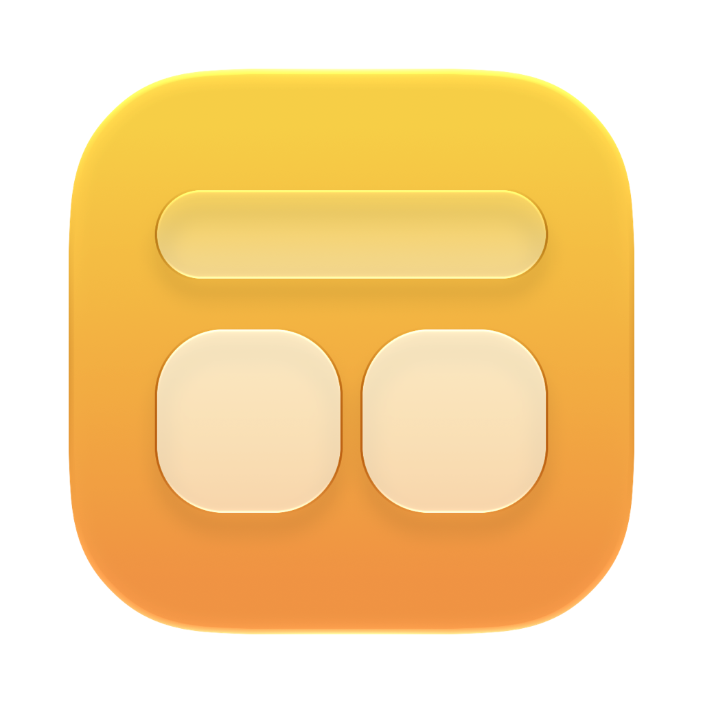

<p align="center"></p>

<h1 align="center">Ledge</h1>

<p align="center">
A desktop shell for macOS, built on top of the <a href="https://github.com/karinushka/paneru">Paneru</a>
tiling window manager. A status bar, a niri-style workspace overview, and a clock that opens into an
island with your calendar and what's playing. Plus all of Paneru's settings and shortcuts in a simple GUI.
</p>

https://github.com/user-attachments/assets/328a74a1-eed5-494d-af5e-2b14f527d811

> **Status: alpha.** I use it every day, but only on one machine: an M1 MacBook Air on macOS 27, one
> display. Intel Macs and multiple displays are untested. Issues welcome.

**How it was made:** The code was written by Claude.  If
something works or looks off to you, it might well be: please open an issue.

## What it does

**The bar**
- Paneru's workspaces as pills: plain, with numbers, or with the apps on them (real icons or
  [sketchybar-app-font](https://github.com/kvndrsslr/sketchybar-app-font) glyphs, built in).
  Scroll over them to switch workspaces
- Right side (status bar), in any order and split into pills where you like: Wi-Fi, network speed, Bluetooth,
  sound (menu with volume and output; right-click mutes, scroll changes volume), battery (drawn like
  macOS 26+ does), keyboard layout, AirDrop, Siri
- Styles: Liquid Glass, Frosted, or Minimal
- Light or dark: matches the wallpaper behind it per display (like the real menu bar), follows the
  system, or stays light or dark
- Clock in the middle or on the right
- Hides on displays where something is full screen
- Without Paneru it still works: the area normally taken up by workspaces shows your open apps

**The overview** (Super + O, or a hot corner)
- All workspaces stacked like niri, with live window previews, the current one in the middle
- Click a window to focus it, a desktop to switch to it; scroll, arrow keys, Return, 1 to 9, Esc
- Drag windows between workspaces or along a workspace to reorder them; the others make room and an
  outline shows where it lands. An empty workspace always waits at the end
- Wide workspaces shrink to fit, so every window stays reachable

**The island** (click the clock)
- A pill next to the clock while something plays sound, with a small animated spectrum
- Track, artwork, a draggable timeline and previous / play / next, when
  [media-control](https://github.com/ungive/media-control) is installed (`brew install media-control`); you can configure which apps show up there
- A month calendar with your events, what's up next, and a Join button for video calls

**Paneru's settings, in Ledge** (Settings → Paneru)
- Space at the screen edges (the top can follow Ledge's bar), gaps between windows, column width
  presets, focus follows mouse, mouse follows focus
- How the sideways swipe behaves (free scroll, glide and settle, one window at a time), its speed
  and glide, and how fast windows move
- All of Paneru's keyboard shortcuts (Settings → Shortcuts), around one Super key you pick.
  Paneru ships with none, so Ledge brings niri's
- Ledge edits `~/.config/paneru/paneru.toml` one line at a time, keeps your comments and saves a
  backup the first time. If you configure Paneru with `init.lua`, Ledge only shows the values

**Also**
- A welcome on first launch that checks for Paneru, explains each permission before macOS asks,
  and points out macOS trackpad gestures that would get in the way
- Apps that always open on a given workspace (Settings → Rules)
- Three-finger swipes up and down to switch workspaces, in the direction you pick, with an
  experimental seamless slide between workspaces
- Opens at login if you want (Settings → Permissions)

## Requirements

- macOS 26 or later (built and used on macOS 27)
- [Homebrew](https://brew.sh), for Paneru and media-control
- [Paneru](https://github.com/karinushka/paneru), recommended: `brew install paneru`. Ledge works
  without it, with fewer features
- Optional: `brew install media-control` for track info and controls (Ledge can install it for you)

## Install

**Download:** get `Ledge.zip` from [Releases](../../releases), unzip it and move Ledge to
Applications. Ledge isn't notarized by Apple yet, so the first time macOS says it can't check it:
open System Settings → Privacy & Security, scroll down and click **Open Anyway** next to Ledge.
After that it opens normally. The welcome walks you through the rest.

**From source** (needs Apple's command line tools: `xcode-select --install`, full Xcode isn't needed):

```
git clone https://github.com/knradf/ledge.git
cd ledge
bash make-cert.sh   # once: a local signing certificate, so permissions survive rebuilds
bash install.sh
```

`install.sh` builds Ledge, copies it to `/Applications`, starts it now and at every login, and stops
SketchyBar if it's running. After changing anything, `bash restart.sh` rebuilds and restarts it.
`bash uninstall.sh` removes it (and starts SketchyBar again if the installer had stopped it).

Settings: click the clock, then Ledge Settings at the bottom of the island, or just open Ledge again.

## Permissions

The welcome explains each one before macOS asks, and you can skip any of them. They're all in
Settings → Permissions later.
- **Accessibility:** focusing and moving windows from the bar and the overview, the overview
  shortcut, three-finger swipes
- **Screen Recording:** window previews in the overview, the workspace slide, matching the wallpaper
- **Calendars:** the island's calendar
- **Bluetooth:** the Bluetooth item, only if you turn it on

Nothing leaves your Mac. Ledge makes no network requests.

## Unofficial macOS features it relies on

Some of what Ledge does has no public API. Each of these could break with a macOS update; Ledge is
written to fall back quietly when one does.

- **`_AXUIElementGetWindow`** (Accessibility): maps an accessibility window to its window id. Every
  macOS window manager uses it (Paneru, yabai, AeroSpace).
- **MultitouchSupport** (private framework): reads finger positions for three-finger swipes, because
  Paneru keeps those gestures out of the normal event stream. Only active when Ledge handles the
  swipes (Settings → Behavior). Same approach as MiddleClick.
- **`responsibility_get_pid_responsible_for_pid`**: tells which app a helper process playing sound
  belongs to (browsers and Electron apps play from helpers).
- **media-control** (optional, separate install): since macOS 15.4 only Apple's apps may read Now
  Playing; media-control works around that through Apple's own signed perl.

Because of these, Ledge can't be on the App Store.

## When something's off

- Log: `cat /tmp/ledge_$(id -u).log` (one per user), or live: `log stream --predicate 'process == "Ledge"'`
- Workspaces empty: check that `paneru query state --json` answers
- Paneru's sideways swipe stops working: that's Paneru
  ([#480](https://github.com/karinushka/paneru/issues/480)); restart it with
  `launchctl kickstart -k gui/$UID/com.github.karinushka.paneru`
- Three-finger swipes do nothing: the log should say "listening for three-finger swipes" and, on the
  first swipe, "three-finger touches are coming through"
- Nothing playing shows up: the log lists every app it hears ("sound from …")

## Code

```
Sources/Ledge/
  App/       entry point, AppDelegate (starts everything, one bar per display), settings, welcome
  Paneru/    Paneru's state and commands, window rules, Paneru's config file
  Overview/  the overview: layout, view, previews, shortcut, hot corner, trackpad swipes
  System/    battery, audio, Wi-Fi, network, Bluetooth, calendar, now playing, wallpaper
  UI/        bar, workspaces, clock and island, status items, settings window, theme
```

Visual constants live in `Sources/Ledge/UI/Theme.swift`.

## Thanks

- [Paneru](https://github.com/karinushka/paneru) by karinushka, which does the actual window management
- [niri](https://github.com/YaLTeR/niri), whose overview this imitates
- [sketchybar-app-font](https://github.com/kvndrsslr/sketchybar-app-font) by kvndrsslr and
  contributors for the app glyphs. It's CC0, so Ledge ships a copy (`Resources/Glyphs`, with its
  license); `scripts/update-glyphs.sh` pulls the latest release
- [media-control](https://github.com/ungive/media-control) and mediaremote-adapter by ungive

## License

MIT, see [LICENSE](LICENSE).
